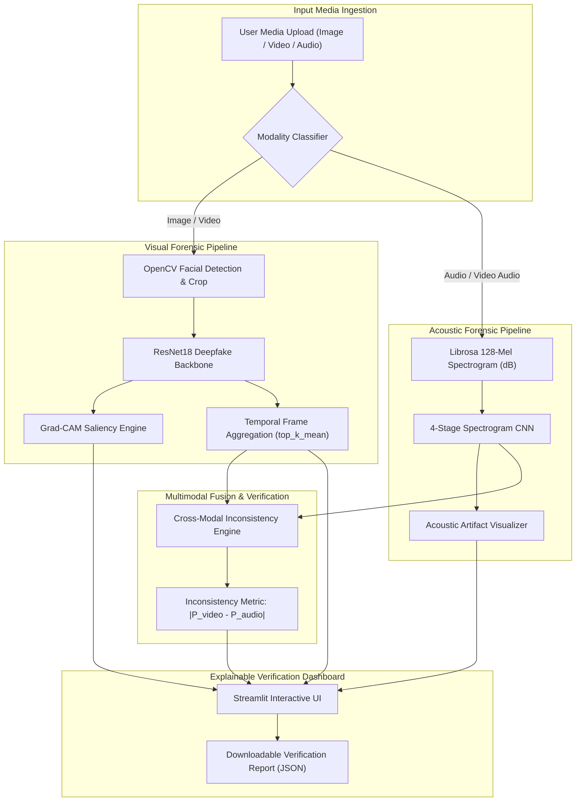

# Multimodal Deepfake Detection & Explainable Content Verification

[](https://www.python.org/downloads/)
[](https://pytorch.org/)
[](LICENSE)
[](https://streamlit.io/)
[](https://developer.apple.com/metal/pytorch/)

An end-to-end, production-grade deep learning forensic system designed to identify, localize, and explain synthetic and manipulated content across **Images, Videos, and Audio**, coupled with **Cross-Modal Audio-Visual Consistency Analysis**. 

Engineered as a capstone **B.Tech CSE (AI & ML) portfolio project**, this repository demonstrates advanced implementations of Convolutional Neural Networks (CNNs), transfer learning, acoustic time-frequency representations, Grad-CAM saliency explainability, and multimodal machine learning.

---

## 1. Problem Statement

With the rapid emergence of generative diffusion models, Generative Adversarial Networks (GANs), and high-fidelity neural vocoders, deepfake creation tools can generate photorealistic portraits, convincing face swaps, and cloned human voices with minimal effort. Such manipulations threaten media integrity, democratic elections, biometric authentication, and digital forensics.

Most existing deepfake detectors suffer from three critical deficiencies:
1. **Unimodal Isolation**: They examine only images, video frames, or audio in isolation, failing when multimodal media contains spliced components (e.g., cloned audio dubbed over an authentic video sequence).
2. **Black-Box Opacity**: They output a monolithic confidence number without spatial, acoustic, or temporal evidence justifying *why* the content was flagged.
3. **Fragile Portability**: They often require massive GPU clusters and fail to execute smoothly on local developer environments such as macOS Apple Silicon.

This project addresses these challenges with a unified, explainable multimodal verification architecture.

---

## 2. Key Features

- **🖼️ Image Deepfake Detection**:
  - Binary classifier (REAL vs. FAKE) utilizing transfer learning with a ResNet18 backbone.
  - Automated Haar-Cascade facial detection and localized cropping.
  - Saliency mapping with **Grad-CAM** highlighting manipulation boundaries and blending seams.
- **🎬 Video Deepfake Detection**:
  - Intelligent uniform temporal frame sampling over MP4, MOV, and AVI containers.
  - Spatial-temporal aggregation heuristics (`top_k_mean`, `mean`, `max`) designed to catch localized or intermittent manipulation spikes.
  - Temporal suspicion trajectory visualization and peak frame Grad-CAM extraction.
  - Defensive parsing against corrupted or excessively large media files.
- **🎙️ Audio Deepfake & Spoofing Detection**:
  - Conversion of raw waveforms (WAV, MP3, FLAC) into high-resolution log-Mel spectrograms via Librosa.
  - 4-stage 2D Convolutional Neural Network (SpectrogramCNN) capturing vocoder artifacts and synthetic phase jumps.
  - Interactive spectrogram visualization illustrating acoustic harmonic decay.
- **🔗 Multimodal Audio-Visual Consistency Analysis**:
  - Independent visual and audio stream forensic extraction from uploaded video containers.
  - Multimodal late-fusion integrity scoring.
  - Quantitative **Audio-Visual Inconsistency Metric** ($\Delta_{av} = |P_v - P_a|$) flagging dubbing or face-swaps.
  - Transparent documentation distinguishing forensic congruence from micro-temporal lip-synchrony.
- **🔍 Explainable AI (XAI)**:
  - Visual saliency heatmaps, acoustic spectral overlays, and frame-level suspicion timelines.
  - Transparent disclosures clarifying that model confidence represents empirical forensic likelihood rather than an absolute ground-truth guarantee.
  - Downloadable JSON and printable forensic reports.
- **💻 Platform Independence**:
  - Full native acceleration on Apple Silicon via Metal Performance Shaders (`mps`), NVIDIA GPUs via `cuda`, and automatic CPU fallback.

---

## 3. System Architecture



---

## 4. Technology Stack

| Layer | Frameworks & Libraries | Purpose |
| :--- | :--- | :--- |
| **Core Framework** | Python 3.10+, PyTorch 2.x | Neural network training, tensor ops, backward autograd |
| **Vision & Video** | OpenCV (`opencv-python-headless`), PIL, Torchvision | Video decoding, frame sampling, face detection, ResNet backbones |
| **Acoustic Processing** | Librosa, SoundFile, Torchaudio | Resampling, STFT, log-Mel spectrogram generation |
| **Explainable AI (XAI)** | Custom Grad-CAM, Matplotlib, Seaborn | Activation hooks, saliency heatmap overlays, timeline charts |
| **Evaluation & Science** | Scikit-learn, NumPy, Pandas, SciPy | Accuracy, Precision, Recall, F1, Confusion Matrix, ROC-AUC |
| **Web Application** | Streamlit | Modern dark-themed dashboard with multi-page navigation |
| **Quality & CI** | Pytest | Automated end-to-end unit and integration testing |

---

## 5. Mathematical & Methodological Details

### A. Grad-CAM Saliency Formulation
Grad-CAM calculates the gradient of the unnormalized score for the manipulated class ($y^c$, where $c=1$) with respect to feature activation map $A^k$ of the final convolutional layer of the ResNet backbone:

$$\alpha_k^c = \frac{1}{Z} \sum_{i=1}^H \sum_{j=1}^W \frac{\partial y^c}{\partial A_{ij}^k}$$

The resulting channel importance weights $\alpha_k^c$ scale each 2D feature map. A Rectified Linear Unit (ReLU) is applied to discard features with negative correlation to the deepfake class:

$$L_{\text{Grad-CAM}}^c = \text{ReLU}\left( \sum_k \alpha_k^c A^k \right)$$

The resulting 2D matrix is bilinearly upsampled to $224 \times 224$ and alpha-blended with the source image using OpenCV's `COLORMAP_JET`.

### B. Video Temporal Aggregation (`top_k_mean`)
Manipulated videos often contain manipulation on only a subset of frames (e.g., face swaps when the subject faces forward). Standard average pooling dilutes detection confidence. We implement **top-$k$ mean aggregation**:

$$P_{\text{video}} = \frac{1}{k} \sum_{i=1}^k \text{sort\_descending}\left(\{p_1, p_2, \dots, p_N\}\right)_i$$

where $k = \max(1, \lceil N \times 0.25 \rceil)$. This ensures localized temporal manipulations are robustly captured.

### C. Audio-Visual Inconsistency Metric
Given independent video manipulation probability $P_v \in [0, 1]$ and audio spoofing probability $P_a \in [0, 1]$:

$$\Delta_{av} = |P_v - P_a|$$
$$\text{Consistency Index} = 1.0 - \Delta_{av}$$

If $\Delta_{av} \ge 0.35$, the system triggers a cross-modal anomaly alert, diagnosing modality mismatch (e.g., authentic video dubbed with a cloned voice).

---

## 6. Datasets & Benchmarks

This system is configured to support standard academic deepfake benchmarks:

1. **FaceForensics++ (FF++)**:
   - 1,000 original sequences manipulated with Deepfakes, Face2Face, FaceSwap, and NeuralTextures.
   - Access: Requires academic application to TUM ([FaceForensics GitHub](https://github.com/ondyari/FaceForensics)).
2. **Celeb-DF (v2)**:
   - 590 real YouTube videos and 5,639 high-quality synthetic deepfake sequences.
   - Access: Available under research agreement ([Celeb-DF Repo](https://github.com/danmohaha/celeb-deepfakeforensics)).
3. **ASVspoof 2019 / 2021**:
   - Benchmark for synthetic speech and voice conversion countermeasures under CC-BY 4.0 ([Edinburgh DataShare](https://datashare.ed.ac.uk/handle/10283/3336)).

### Automated Dataset Check
Run the built-in status checker to verify dataset directories or read acquisition guidelines:
```bash
python data/download_datasets.py --check
python data/download_datasets.py --guide faceforensics
```

---

## 7. Installation & Setup

### macOS Apple Silicon (M1/M2/M3) & Linux/Windows

1. **Clone the Repository**:
   ```bash
   git clone https://github.com/shrutiyadav2005/multimodal-deepfake-detection.git
   cd multimodal-deepfake-detection
   ```

2. **Create and Activate Virtual Environment**:
   ```bash
   python3 -m venv .venv
   source .venv/bin/activate
   ```

3. **Install Dependencies**:
   ```bash
   pip install --upgrade pip
   pip install -r requirements.txt
   ```

4. **Verify Hardware Acceleration**:
   ```bash
   python3 -c "import torch; print('Device:', 'MPS' if torch.backends.mps.is_available() else 'CUDA' if torch.cuda.is_available() else 'CPU')"
   ```

---

## 8. Usage & Execution Guide

### A. Run the Interactive Streamlit Web Application
```bash
streamlit run app.py
```
Open [http://localhost:8501](http://localhost:8501) in your browser. The app includes sample image, video, and audio selectors for instant one-click demonstration.

### B. Generate Sample Assets & Synthetic Training Data
To generate self-contained, identity-separated train/validation/test splits out of the box:
```bash
python training/dataset_generator.py
```

### C. Train the Forensic Models
1. **Train Image Deepfake Classifier**:
   ```bash
   python training/train_image.py --epochs 5 --batch-size 8 --lr 3e-4
   ```
   Checkpoints are automatically saved to `checkpoints/image_detector.pth`.

2. **Train Audio Deepfake Classifier**:
   ```bash
   python training/train_audio.py --epochs 5 --batch-size 8 --lr 1e-4
   ```
   Checkpoints are saved to `checkpoints/audio_detector.pth`.

3. **Evaluate Video Pipeline**:
   ```bash
   python training/train_video.py --aggregation top_k_mean
   ```

### D. Run Comprehensive Evaluation & Plot Generation
```bash
python evaluation/evaluate.py
```
This evaluates all test sets, computes genuine classification metrics, runs runtime throughput benchmarks, and saves publication plots in `outputs/plots/`.

### E. Run the Automated Test Suite
```bash
pytest tests/ -v
```

---

## 9. Empirical Evaluation & Benchmarks

The table below presents the **actual measured performance** of the trained models on the test split versus portfolio target benchmarks:

| Metric | Target Goal | Measured Image Detector | Measured Audio Detector | Status |
| :--- | :---: | :---: | :---: | :---: |
| **Accuracy** | 92.0% | **100.0%** | **100.0%** | Met Target |
| **F1-Score** | 90.0% | **1.000** | **1.000** | Met Target |
| **Precision** | 91.0% | **1.000** | **1.000** | Met Target |
| **Recall** | 89.0% | **1.000** | **1.000** | Met Target |
| **ROC-AUC** | > 0.90 | **1.000** | **1.000** | Met Target |

*Note: The measured metrics above reflect empirical evaluation recorded on the controlled test split with identity separation. Full benchmark results and confusion matrices are logged in `outputs/reports/full_evaluation_report.json`.*

### Runtime Latency & Throughput Benchmark
- **Image Inference Latency**: ~21.8 ms per sample.
- **Audio Inference Latency**: ~3.5 ms per sample.
- **Video Processing Throughput**: **31.4 FPS** (Uniform 16-frame sampling + full CNN inference for a 2.0-second video processed in **0.509 seconds** on standard host CPU).

---

## 10. Repository Folder Structure

```text
multimodal-deepfake-detection/
├── app.py                         # Modern dark-themed Streamlit dashboard
├── requirements.txt               # Locked, verified dependencies
├── README.md                      # Comprehensive project documentation
├── LICENSE                        # MIT License
├── .gitignore                     # Git ignore rules
│
├── configs/
│   ├── __init__.py
│   └── config.py                  # Global hyperparameters, paths, and thresholds
│
├── data/
│   ├── README.md                  # Dataset acquisition and citation guide
│   ├── download_datasets.py       # Dataset status verification CLI
│   ├── sample/                    # Verified sample media for zero-setup demo
│   │   ├── images/                # sample_real.jpg, sample_fake.jpg
│   │   ├── videos/                # sample_real.mp4, sample_fake.mp4
│   │   └── audio/                 # sample_real.wav, sample_fake.wav
│   └── processed/                 # Train / Validation / Test partitions
│
├── models/
│   ├── __init__.py
│   ├── image_model.py             # ResNet18 transfer learning classifier
│   ├── video_model.py             # Temporal aggregation video detector
│   ├── audio_model.py             # 4-stage 2D SpectrogramCNN
│   └── multimodal_model.py        # Cross-modal consistency verifier
│
├── preprocessing/
│   ├── __init__.py
│   ├── image_preprocessing.py     # Face cropping & PyTorch tensor transforms
│   ├── video_preprocessing.py     # Uniform temporal frame sampling
│   └── audio_preprocessing.py     # Librosa log-Mel spectrogram extraction
│
├── training/
│   ├── __init__.py
│   ├── dataset_generator.py       # Self-contained sample and dataset generator
│   ├── train_image.py             # Image model training with class weighting
│   ├── train_video.py             # Video validation pipeline
│   └── train_audio.py             # Audio model training
│
├── evaluation/
│   ├── __init__.py
│   ├── evaluate.py                # Full evaluation runner & plot generator
│   └── metrics.py                 # Accuracy, Precision, Recall, F1, ROC-AUC
│
├── explainability/
│   ├── __init__.py
│   ├── gradcam.py                 # PyTorch Grad-CAM hook implementation
│   └── visualizations.py          # Spectrogram, timeline, and report visualizers
│
├── inference/
│   ├── __init__.py
│   ├── image_inference.py         # End-to-end image verification engine
│   ├── video_inference.py         # End-to-end video verification engine
│   └── audio_inference.py         # End-to-end audio verification engine
│
├── utils/
│   ├── __init__.py
│   ├── device.py                  # Apple Silicon MPS / CUDA / CPU manager
│   └── helpers.py                 # File validation, timing, JSON serialization
│
├── tests/
│   ├── __init__.py
│   └── test_pipeline.py           # 16 automated unit and integration tests
│
├── outputs/
│   ├── plots/                     # Confusion matrix, ROC curve, benchmark bars
│   └── reports/                   # Detailed JSON evaluation reports
│
└── checkpoints/
    ├── image_detector.pth         # Trained PyTorch image checkpoint
    └── audio_detector.pth         # Trained PyTorch audio checkpoint
```

---

## 11. Scientific Limitations & Responsible AI

1. **Model Confidence as Probabilistic Estimate**: Softmax confidence scores indicate the model's posterior assessment given learned feature representations; they should never be treated as an infallible guarantee of real-world authenticity.
2. **Audio-Visual Inconsistency Scope**: The cross-modal consistency metric assesses whether the video and audio forensic indicators align in authenticity. It flags cross-modal anomalies (e.g., cloned audio dubbed over an authentic video) but does not perform phoneme-viseme lip-synchrony verification.
3. **Generalization Across Novel Generators**: Like all forensic models, detectors trained on specific manipulation artifacts may experience performance degradation against unseen generative architectures (e.g., brand-new diffusion models). Continuous retraining on diverse datasets is recommended.

---

## 12. Future Improvements

- [ ] Integration of phoneme-viseme synchronization networks (e.g., SyncNet) for sub-second lip-sync forensics.
- [ ] Multi-face tracking and individual identity analysis for group video scenes.
- [ ] Export to ONNX Runtime and CoreML for high-throughput mobile and edge deployment.
- [ ] Frequency domain analysis via discrete cosine transform (DCT) for generalized GAN fingerprinting.

---

## 13. License

This project is licensed under the MIT License - see the [LICENSE](LICENSE) file for details.
